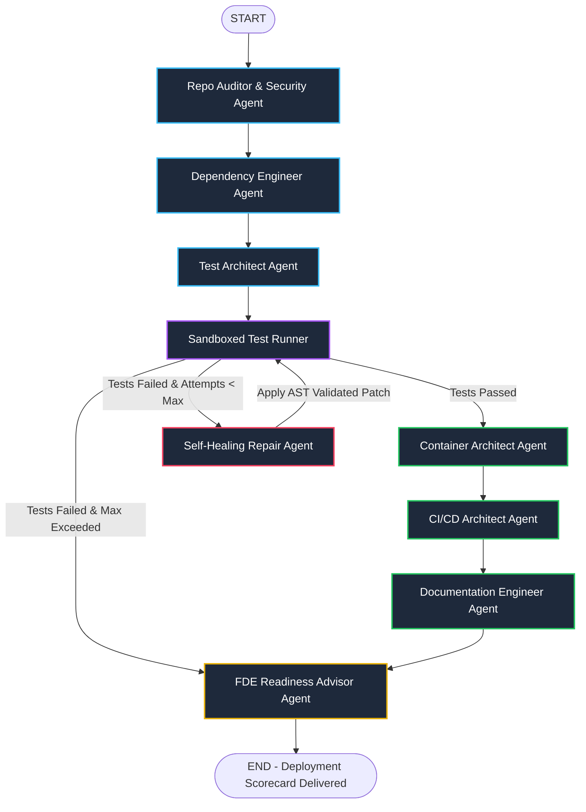

# 🚀 Forward Deployment Engineer (FDE) Autonomous Multi-Agent System

An enterprise-grade, production-ready multi-agent platform orchestrated using **LangGraph** and **LangChain**. Built specifically for the **Forward Deployment Engineer (FDE)** role, this platform automates the end-to-end lifecycle of inspecting client repositories, auditing security risks, resolving reproducible dependencies, generating isolated test suites, executing self-healing reflection loops, generating hardened container specifications, and delivering deployment readiness scorecards.

---

## 🏗️ System Architecture

The platform models the Forward Deployment workflow as a stateful, cyclical multi-agent graph with typed Pydantic state persistence and automated error escalation.



---

## 🤖 The 9 Specialized FDE Agents

| Agent | Responsibility | Output Artifact |
| :--- | :--- | :--- |
| **1. Repo Auditor (`discovery.py`)** | Static AST analysis, framework discovery, entrypoint detection, and credential/secret leak scanning. | `ProjectProfile`, `SecurityFinding[]` |
| **2. Dependency Engineer (`dependencies.py`)** | AST import extraction, stdlib exclusion, PyPI package mapping, and pinned dependency management. | `requirements.txt`, `DependencyAudit` |
| **3. Test Architect (`test_architect.py`)** | Designs comprehensive test plans and generates isolated `pytest` suites with full mocking of network, database, hardware, and GUI operations. | `test_*.py`, Test Plans |
| **4. Sandboxed Test Runner (`test_execution.py`)** | Subprocess test runner with strict execution timeouts, isolated `PYTHONPATH`, and regex telemetry parsing. | `TestExecutionResult` |
| **5. Self-Healing Engineer (`self_healing.py`)** | **Cyclical Reflection Loop**: Diagnoses root causes (source bug vs. test bug vs. environment issue), generates targeted patches, validates syntax via `ast.parse`, and safely commits fixes with backups (`.bak`). | `RepairRecord[]`, AST Validated Patches |
| **6. Container Architect (`container.py`)** | Generates hardened, multi-stage Dockerfiles adhering to enterprise security policies (pinned slim base, unprivileged non-root user `appuser`, layer caching, healthchecks). | `Dockerfile`, `.dockerignore` |
| **7. CI/CD Architect (`cicd.py`)** | Generates production GitHub Actions workflows with linting (`ruff`), SAST security scanning (`bandit`), Python matrix testing (3.10, 3.11, 3.12), and container smoke tests. | `.github/workflows/ci-cd.yml` |
| **8. Documentation Engineer (`documentation.py`)** | Synthesizes technical architecture, prerequisite tables, API references, runbooks, and handover guides into clean Markdown. | `README.md` |
| **9. FDE Readiness Advisor (`readiness_advisor.py`)** | Computes objective 0-100 Deployment Readiness Score across 4 dimensions (Quality, Security, Container, CI/CD) and delivers the executive handover briefing. | `DEPLOYMENT_READINESS_REPORT.md` |

---

## ⚡ Quickstart & Setup

### 1. Prerequisites
- Python 3.10+ (Python 3.11 recommended)
- OpenRouter API Key (or OpenAI / Azure OpenAI credentials)

### 2. Installation
```bash
# Clone and navigate to workspace
cd d:\GEN_AI

# Install dependencies
py -m pip install -r requirements.txt
```

### 3. Environment Configuration
Create or update `.env` in the project root:
```env
OPENROUTER_API_KEY=sk-or-v1-...
OPENROUTER_MODEL=openai/gpt-4o-mini
FALLBACK_MODEL=openrouter/free
MAX_REPAIR_ATTEMPTS=3
TEST_TIMEOUT_SECONDS=45
```

---

## 💻 CLI Usage

### Full End-to-End Forward Deployment Run
Run the full multi-agent pipeline on a client project:
```bash
# Using modern CLI
py cli.py run "C:\path\to\client_project"

# Or using main.py entrypoint
py main.py "C:\path\to\client_project" --max-repairs 3
```

### Discovery & Security Audit Only
Perform an immediate audit of repository structure, frameworks, and security risks without modifying files:
```bash
py cli.py audit "C:\path\to\client_project"
```

---

## 🧪 Automated Test Verification

Run the test suite covering state schemas, code validation, dependency resolution, scoring algorithms, and the LangGraph multi-agent graph:
```bash
py -m pytest tests/ -v
```

---

## 🔒 Enterprise Security Hardening

- **TLS Verification Enforced**: Replaced insecure `httpx.Client(verify=False)` with TLS-verified LangChain Chat models.
- **AST Safety Guard**: Code patches generated by self-healing agents are parsed and verified using Python's `ast.parse()` before being committed to disk.
- **Automated Rollback**: All file modifications create `.bak` backups automatically to safeguard customer code.
- **Principle of Least Privilege**: Generated Dockerfiles enforce unprivileged user execution (`USER appuser`) with UID 10001.
- **Credit & Rate-Limit Fallbacks**: Automatic fallback handling for API 402/quota limits with exponential backoff.

